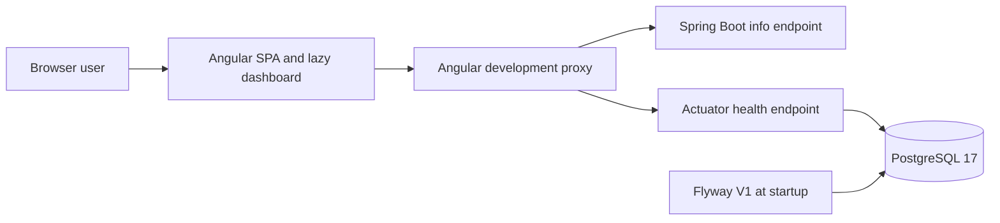
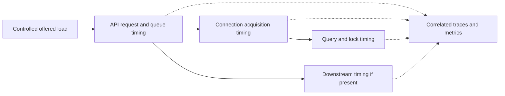
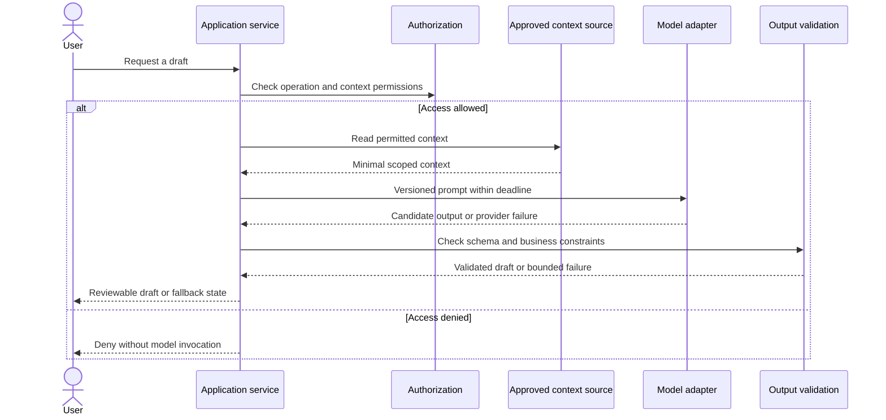

# Architecture views

[Portfolio](../README.md) · [FlowDesk audit](../projects/flowdesk.md) · [Decision index](../adr/README.md)

## Implemented FlowDesk foundation

Repository-supported at `d4b7895e4722e565c32b62d2ee162f610e5bc59e`. This view describes local development, not a production topology. The business module boundaries are planned.

The info endpoint returns static application/stage information; it does not query `app_users`. The health check reflects datasource availability. Flyway creates schema groundwork. There is no implemented business service, authentication boundary or deployed microservice network in this diagram.

Sources: [connection service](https://github.com/khaiminh0401/flowdesk/blob/d4b7895e4722e565c32b62d2ee162f610e5bc59e/apps/web/src/app/features/dashboard/system-status.service.ts), [API configuration](https://github.com/khaiminh0401/flowdesk/blob/d4b7895e4722e565c32b62d2ee162f610e5bc59e/apps/api/src/main/resources/application.yml), [local database setup](https://github.com/khaiminh0401/flowdesk/blob/d4b7895e4722e565c32b62d2ee162f610e5bc59e/docker-compose.yml).

## Proposed performance investigation

This diagram is an observation map for a future sanitized performance study. It is not the VNPT architecture or the current FlowDesk request path.

Measure where requests wait before changing queries, concurrency, pool limits or caching. See [backend case study](../case-studies/backend-api-performance.md).

## Proposed LLM workflow

Proposed for the [LLM case study](../case-studies/llm-application-integration.md); no public runtime implementation is claimed.

User acceptance and persistence are separate: re-authorize when applying a draft. Context content and model output cannot change access policy. The context source may be direct records; RAG is optional and must have explicit evidence before being described as implemented.

Editable standalone Mermaid sources live in [assets/diagrams](../assets/diagrams/README.md). The Markdown views are canonical; synchronize sources if changing a diagram.
